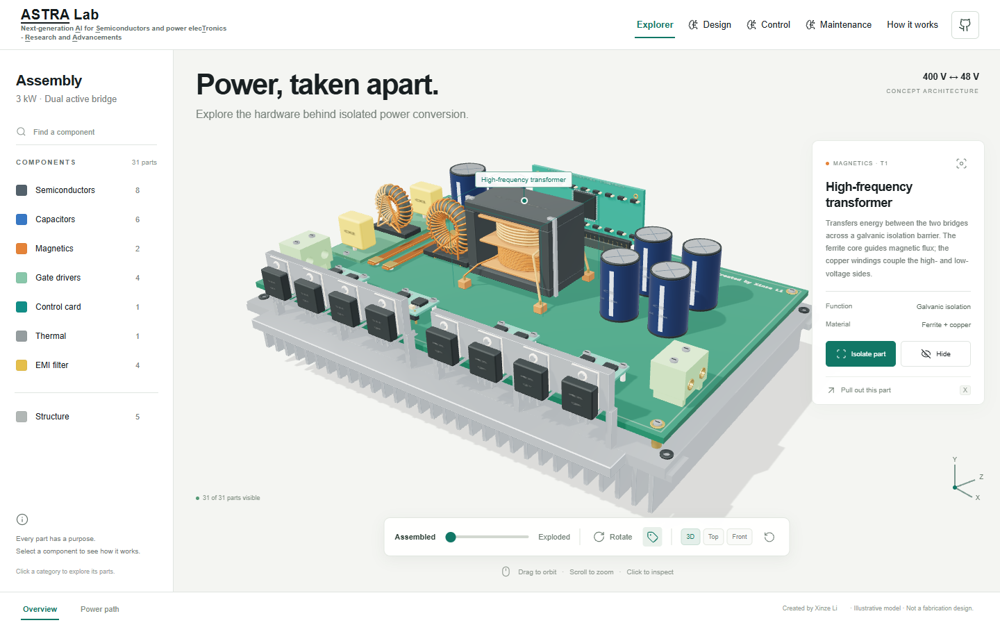

# Explore the Application of Artificial Intelligence in Power Electronics

Explore the basics of artificial intelligence for power electronics through an interactive 3D converter and hands-on neural-network examples. The site connects physical hardware to three areas where AI can support engineering: **design, control, and maintenance**.

## Explore the 3D model

<a href="https://xinzelee.github.io/AI4PE-explorer/"></a>

[](https://xinzelee.github.io/AI4PE-explorer/)

Rotate and zoom the conceptual dual-active-bridge converter, select its components, and separate or reassemble the hardware. Explore its semiconductors, capacitors, magnetics, gate drivers, control board, heatsink, and EMI filter.

## Three ways to learn

| Case study | What you can explore |
| --- | --- |
| **Design** | See a conceptual AI-assisted design workflow, then change power-module geometry and explore a neural-network estimate of loop inductance in 2D and 3D. |
| **Control** | Follow an illustrated control workflow with triple-phase-shift waveforms, then use a companion DAB neural-network example to predict current stress and zero-voltage-switching counts. |
| **Maintenance** | Explore how operating signals can inform condition monitoring, then inspect recorded IGBT waveforms with a neural-network estimate of remaining life and a 90% prediction interval. |

The converter hardware and workflow diagrams are educational illustrations. The interactive neural-network playgrounds are separate research examples using fixed, locally evaluated models; their predictions are not measurements or validation of the pictured converter.

## Run locally

Install Node.js 22.12 or later, open a terminal in the project directory, and run:

```sh
npm ci
npm run dev -- --port 4173
```

Open the address printed in the terminal, usually [http://127.0.0.1:4173/](http://127.0.0.1:4173/). Drag to orbit the model, scroll to zoom, and click a component to learn about it. The application and its neural-network inference run in the browser; no separate inference server is required.

## Sources and further reading

- [Fundamentals of AI for Power Electronics](https://github.com/XinzeLee/Fundamentals_of_AI_for_PE)
- [ECCE2025 DAB tutorial and data](https://github.com/XinzeLee/ECCE2025/tree/1732da388f18b80e3fb6ad2ed0480c53f42c9250)
- [IGBT remaining-life case study](https://github.com/XinzeLee/Fundamentals_of_AI_for_PE/tree/0587acf5854b0127f696c13e0367663d24f6ae73/9_Case_Studies_PE/IGBT_Maintenance)
- [PowerSynth source and benchmark attribution](public/models/design-nn/source/THIRD_PARTY.md)

Created by **Xinze Li**. The project includes third-party materials with their own license notices, including the [PowerSynth GPL license](public/models/design-nn/source/LICENSE-GPL-3.0.txt) and the [IGBT case-study notice](public/models/rul-nn/source/NOTICE).
